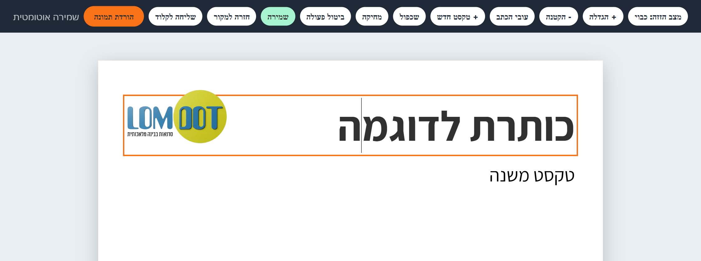

# עיצוב עם עורך מובנה: סקיל לקלוד

מבקשים מקלוד פלייר, באנר, מודעה, הזמנה או סטורי, ומקבלים שני קבצים:

- **תמונה מוכנה** לשליחה מיד.
- **קובץ עריכה** שנפתח בדפדפן. בו משנים טקסט, גודל, עובי ומיקום, מוסיפים ומוחקים, ומורידים תמונה חדשה. בלי לדעת לתכנת ובלי לחזור לשיחה על כל מילה.

## הורדה

1. לוחצים על הקובץ **[editable-design.zip](editable-design.zip)**.
2. בעמוד שנפתח לוחצים על כפתור ההורדה (Download raw file).

מדריך מעוצב להדפסה או לשליחה: **[מדריך התקנה ושימוש (PDF)](docs/guide-he.pdf)**

## התקנה בצ'אט הרגיל (claude.ai)

1. נכנסים ל-claude.ai ופותחים **Settings**.
2. בוחרים **Capabilities**, ובאזור **Skills** לוחצים **Upload skill**.
3. בוחרים את הקובץ **editable-design.zip**.
4. מוודאים שהסקיל מסומן כפעיל.

## התקנה בקלוד קוד (Claude Code)

מעתיקים את התיקייה `editable-design` לתיקייה:

- Windows: `C:\Users\<שם המשתמש>\.claude\skills\`
- Mac: `~/.claude/skills/`

## איך מבקשים

> עצב לי פלייר לערב הורים ב־12.11 בשעה 18:00, עם עורך

קלוד ישלח תמונה וקובץ עריכה. בצ'אט הרגיל מורידים את קובץ העריכה ופותחים אותו בכרום או באדג'. בתוך חלון הצ'אט השמירה וההורדה לא תמיד עובדות.

## הכלים בעורך

| כפתור | מה הוא עושה |
|---|---|
| מצב הזזה | כשהוא דולק גוררים חלקים בעכבר. כשהוא כבוי כותבים |
| + הגדלה / - הקטנה | גודל הטקסט שנבחר |
| עובי הכתב | רגיל, בינוני, מודגש, מודגש מאוד |
| + טקסט חדש | מוסיף שורה שאפשר לכתוב בה ולגרור |
| שכפול | עותק באותו עיצוב, מתחת למקור |
| מחיקה, ביטול פעולה | מה שנמחק בטעות חוזר |
| שמירה | נשמר גם לבד אחרי כל שינוי |
| חזרה למקור | מוחק את כל השינויים |
| שליחה לקלוד | כשמשהו התבלגן, מוריד קובץ קטן. מעלים אותו לשיחה וקלוד מסדר |
| הורדת תמונה | שומרת את העיצוב כתמונה |

**חשוב לדעת:** השינויים נשמרים בדפדפן ובמחשב שבהם עורכים. מי שמקבל מכם את קובץ העריכה יראה את העיצוב המקורי. כדי לשתף את הגרסה שלכם, שלחו את התמונה.

## רישיון

חופשי לשימוש, לשינוי ולשיתוף (MIT). אשמח לקרדיט.

---

נוצר על ידי **שירה רוט זליקוביץ**, לומדות: סדנאות בבינה מלאכותית · [lomdot.org](https://www.lomdot.org/)

